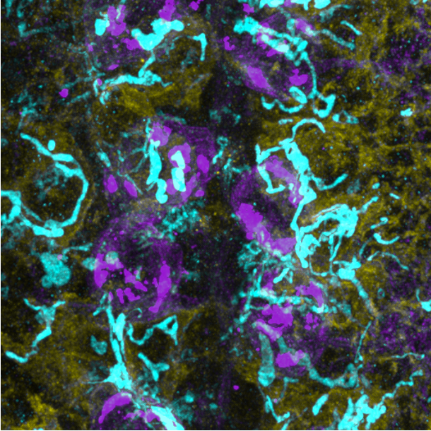

# Expansion microscopy test of larval Drosophila brains

2026-03-06

Related issue: [#1](../../issues/1)

## Goal

The goal of this experiment was to test whether the current antibody staining protocol for neurons, mitochondria, and astrocytes would 
survive intact-tissue expansion microscopy. A second goal was to assess whether light activation is associated with increased 
astrocyte-derived mitochondrial surface reconstructed within activated neurons.

## Sample

Brains were collected from 8 h ALH *Drosophila melanogaster* larvae with genotype 
`RN2-LexA, LexAop-Chrimson::TdTomato, 25H07-Gal4, UAS-mito::GFP`. Tissue was fixed in 4% PFA, immunostained for TdTomato, GAT, and GFP, 
embedded for expansion microscopy, and imaged after expansion.

In the representative post-expansion image, TdTomato is shown in magenta, GAT-positive astrocytes are shown in yellow, 
and GFP-labeled mitochondria are shown in cyan. The sample was imaged on a Zeiss LSM 980 Airyscan microscope using a 40x water-immersion 
objective.

## Reagents

| Reagent | Vendor | Catalog number | Stock concentration | Final concentration |
|---|---|---|---|---|
| Paraformaldehyde, EM-grade aqueous solution | Electron Microscopy Sciences | 15700 | 16% | 4% in PBS |
| Phosphate-buffered saline, no Ca2+, no Mg2+, pH 7.4 | Corning | 21-040-CV | 1x | 1x |
| Triton X-100 | Millipore Sigma | T8787 | stock solution | 0.1% in PBS for permeabilization/blocking; 0.5% in digestion buffer |
| Goat serum | Millipore Sigma | G9023 | stock solution | 5% in blocking buffer |
| Chicken anti-GFP antibody | Aves | GFP-1020 | stock solution | 1:1000 |
| Rabbit anti-GAT antibody | Marc Freeman lab (housemade) | N/A | stock solution | 1:300 |
| Rat anti-mCherry antibody | Thermo Fisher Scientific | 740003T | stock solution | 1:500 |
| Acryloyl-X, SE | Thermo Fisher Scientific | A20770 | 10 mg/mL in anhydrous DMSO | 0.1 mg/mL in PBS |
| DMSO, anhydrous | Thermo Fisher Scientific | D12345 | stock solution | used to prepare AcX stock |
| Sodium acrylate | Combi-Blocks | QC-1489 | 38 g/100 mL stock solution | 8.6 g/100 mL in Stock X |
| Acrylamide | Millipore Sigma | A9099-25G | 50 g/100 mL stock solution | 2.5 g/100 mL in Stock X |
| N,N'-Methylenebisacrylamide | Millipore Sigma | M7279-25G | 2 g/100 mL stock solution | 0.15 g/100 mL in Stock X |
| Sodium chloride | Thermo Fisher Scientific | S271-500 | 5 M stock equivalent in Stock X preparation | 11.7 g/100 mL in Stock X; 1 M in digestion buffer |
| 10x PBS | Thermo Fisher Scientific | 70011044 | 10x | 1x in Stock X |
| TEMED | Millipore Sigma | T9281-25ML | 10 g/100 mL stock solution | 0.2 g/100 mL in gelling solution |
| Ammonium persulfate | Millipore Sigma | A3678-25G | 10 g/100 mL stock solution | 0.2 g/100 mL in gelling solution |
| 4-Hydroxy-TEMPO | Millipore Sigma | 176141-1G | 0.5 g/100 mL stock solution | 0.01 g/100 mL in intact-tissue gelling solution |
| EDTA disodium salt solution | Millipore Sigma | 3690-100ML | stock solution | 1 mM in digestion buffer |
| Tris buffer, pH 8.0 | VWR | E199-500ML | 1 M | 50 mM in digestion buffer |
| Proteinase K | New England Biolabs | P8107S | 800 U/mL stock used for dilution | 8 U/mL in digestion buffer |

## Procedure

1. Dissect 8 h ALH larval *Drosophila* brains carrying `RN2-LexA, LexAop-Chrimson::TdTomato, 25H07-Gal4, UAS-mito::GFP`.
2. Fix brains in 4% PFA in PBS for 12 minutes at room temperature.
3. Permeabilize tissue in 0.1% Triton X-100 in PBS for 15 minutes at room temperature, then block in 5% goat serum in PBS with 0.1% Triton X-100 for 6 hours at room temperature.
4. Incubate tissue with primary antibodies in blocking buffer overnight on a shaker. Primary antibodies were rabbit anti-GAT (1:300), chicken anti-GFP (1:1000), and rat anti-DsRed (1:500).
5. Wash tissue 4 times for 30 minutes each with blocking buffer, then incubate with secondary antibodies in blocking buffer overnight on a shaker.
6. Wash tissue 4 times for 30 minutes each with blocking buffer, then transfer the sample into 0.1 mg/mL Acryloyl-X, SE in PBS and incubate overnight at room temperature without shaking.
7. Wash tissue 2 times for 15 minutes each with PBS, then embed the sample in freshly prepared cold gelling solution for intact tissues composed of Stock X, 4HT, TEMED, and APS at a 47:1:1:1 ratio.
8. Polymerize the gel at 37°C for 1 hour, trim the gel around the sample, and immerse it in digestion buffer containing 8 U/mL Proteinase K.
9. Digest the gel overnight at room temperature in the dark, then expand the sample in water with three 20-minute water exchanges until the gel reached stable expansion.
10. Image post-expanded tissue on a Zeiss LSM 980 Airyscan microscope with a 40x water-immersion objective and quantify normalized astrocyte-derived mitochondrial surface reconstructed within neurons in Imaris from 10 no-light and 10 light-activated images.

## Result

*Figure 1. Post-expanded 8 h ALH larval Drosophila brain stained for TdTomato (magenta), GAT-positive astrocytes (yellow), 
and GFP-labeled mitochondria (cyan). Image produced by Dunham Clark using a Zeiss LSM 980 Airyscan microscope with a 40x water-immersion 
objective.*

The antibody staining for neurons, astrocytes, and mitochondria remained detectable after expansion microscopy, 
and the expanded tissue retained interpretable morphology. The final expansion factor was approximately 4x.

Normalized total astrocyte-derived mitochondrial surface reconstructed within neurons was quantified in 10 images per condition in Imaris.

No-light values: 0.01809843078, 3.146658989, 0.05717458816, 0.8288258643, 2.797030212, 0.7938629867, 1.394401826, 0.5306130843, 0.1700841166, 0.2632499023

Light-activated values: 5.984821998, 14.10854945, 14.02628386, 6.725212348, 9.193180182, 6.087653991, 4.421775703, 4.031014129, 3.228924583, 9.851304938

In this dataset, the light-activated condition showed higher normalized astrocyte-derived mitochondrial surface reconstructed within 
neurons than the no-light condition, supporting further testing of whether neuronal activation promotes astrocyte-to-neuron mitochondrial 
transfer.
